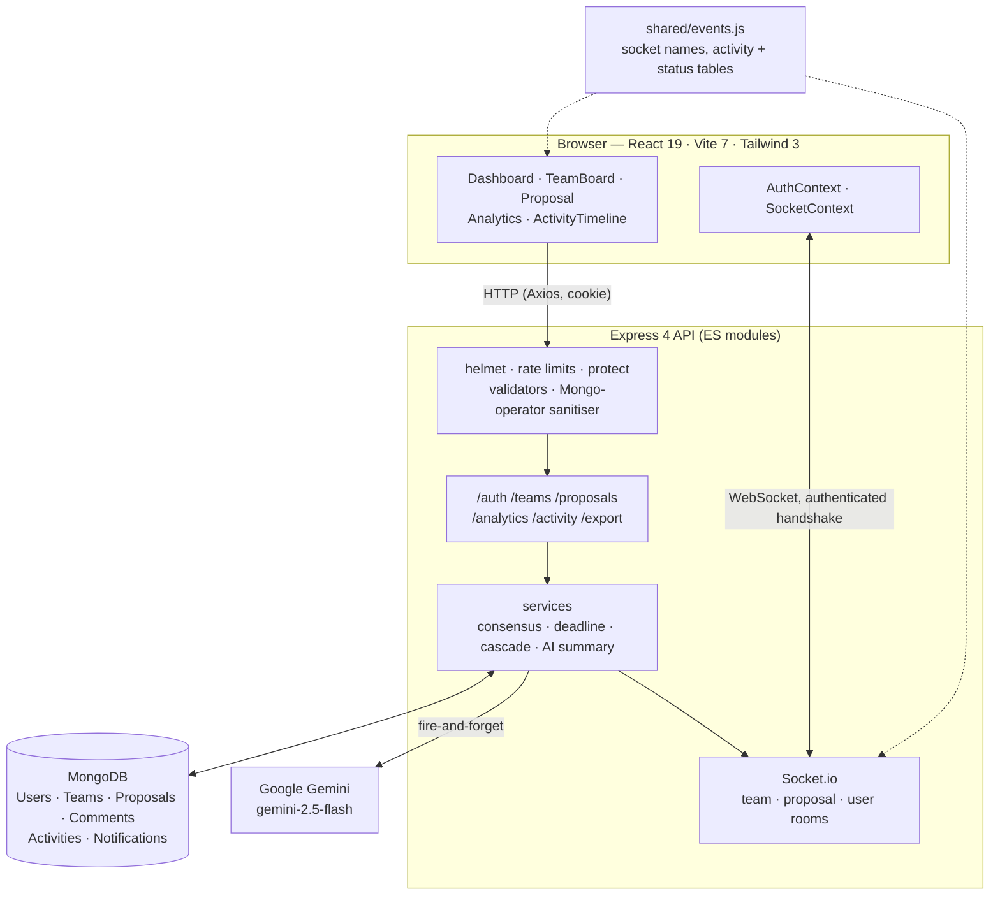
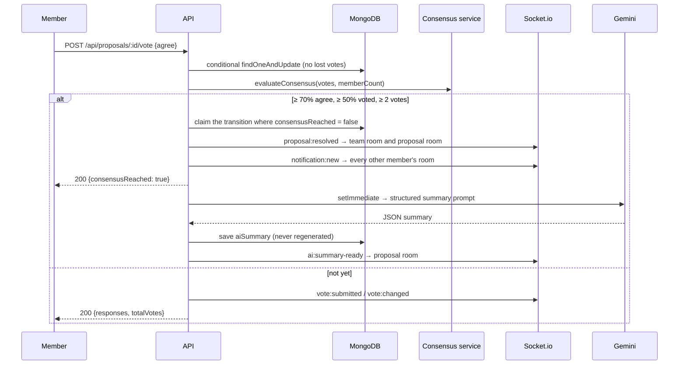

# Team Decision Board

<p align="center">
  <a href="Team-Dashboard%20Demo.mp4">
    
  </a>
  <br>
  <sub>▶ <b><a href="Team-Dashboard%20Demo.mp4">Watch the Team-Dashboard demo</a></b> (74 s): the first roadmap, the 30 July audit, 52 commits, CI run #8 (red on Node 22), and three users voting a proposal to consensus live on a fresh clone</sub>
</p>

**Teams propose, vote and reach consensus in real time — and Gemini writes up the decision the moment it is made.**

[](.github/workflows/ci.yml)
[](frontend/package.json)
[](backend/package.json)
[](backend/models)
[](shared/events.js)
[](backend/services/aiSummaryService.js)
[](LICENSE)

Team discussions get fragmented across email and group chats, and nobody can
find the decision — or the reasoning — a week later. Team Decision Board gives
it a structure: a member posts a proposal, everyone votes Agree / Neutral /
Disagree, progress bars move live on every screen, consensus is detected
automatically, and an AI summary of the arguments and outcome is saved with the
proposal. Results export to Markdown or PDF, and a public link shows them
read-only.

---

## Contents

| Section | |
|---|---|
| [What it does](#what-it-does) | The feature surface, by area |
| [Architecture](#architecture) | SPA, API, sockets, database, Gemini |
| [How a vote becomes a decision](#how-a-vote-becomes-a-decision) | Vote, consensus, summary, notify |
| [Quick start](#quick-start) | One workspace install, one command |
| [Project status](#project-status) | What ships, and what CI proves |
| [Design decisions](#design-decisions) | Consensus rules, security, and why |
| [Reference](#reference) | API routes and socket events |
| [Repository layout](#repository-layout) | Where things live |
| [Documentation](#documentation) | Which file answers which question |
| [Team](#team) | Who built it |

---

## What it does

| Area | Capabilities |
|---|---|
| **Accounts** | Register, login, logout, profile and password changes, account deletion with cascading cleanup |
| **Teams** | Create teams, join with a share code, member lists, a public read-only board link |
| **Proposals & voting** | Title, description and optional custom options; votes changeable until consensus; deadlines |
| **Real time** | Team, proposal and personal rooms; live votes, comments, resolutions and notifications without a refresh |
| **Consensus engine** | Auto-resolves at ≥ 70% agree with ≥ 50% of members voting and at least two votes |
| **AI summaries** | Gemini writes an executive summary, supporting and opposing arguments, outcome and next action — once per proposal |
| **Analytics** | Teams, proposals, acceptance and participation rates, a 14-day trend and a voting-distribution chart (Recharts) |
| **Activity** | A paginated audit log of nine action types, prepended live |
| **Export** | Markdown with vote table, consensus banner, summary and thread; server-side PDF via PDFKit |
| **Security** | httpOnly cookie sessions, authenticated socket handshakes, membership-scoped routes, CSP, four-tier rate limits, input sanitising |

---

## Architecture



`shared/events.js` is imported by both halves, so the socket contract between
the SPA and the server cannot drift.

---

## How a vote becomes a decision



The vote response never waits on Gemini. Without `GEMINI_API_KEY` the summary
step returns silently and everything else works.

---

## Quick start

> Requirements: Node 18.18+, MongoDB (local or Atlas), and optionally a Gemini
> API key.

```bash
# 1 — one npm workspace install covers shared, backend and frontend
git clone https://github.com/guru-bharadwaj20/Team-Dashboard.git
cd Team-Dashboard && npm install

# 2 — environment: MONGO_URI and a JWT_SECRET of 32+ characters at minimum
cp backend/.env.example backend/.env
cp frontend/.env.example frontend/.env
node -e "console.log(require('crypto').randomBytes(48).toString('hex'))"

# 3 — optional: collections, validators and indexes (idempotent, seeds nothing)
mongosh "$MONGO_URI" backend/setup-database.mongodb.js

# 4 — run: API on :5000, web on :5173
npm run dev

# 5 — what CI runs
npm run lint && npm test && npm run build
```

Upgrading a database from before comments had their own collection? Run
`npm run migrate:comments` (dry run by default, `-- --apply` to perform it).

### Production

| Component | Platform |
|---|---|
| Frontend | Vercel — set `VITE_API_URL` to the API origin plus `/api` |
| Backend | Railway / Render — `NODE_ENV=production`, `CLIENT_URL`, `TRUST_PROXY_HOPS=1`, `JWT_SECRET`, `MONGO_URI` |
| Database | MongoDB Atlas — account and team deletion then run in a transaction |

The session is a cross-site cookie in production, which browsers accept only as
`Secure` + `SameSite=None`. **Both** the SPA and the API must be on HTTPS, or
sign-in will appear to succeed and then immediately fail.

---

## Project status

Feature-complete for its scope. Delivered since the first release: role-based
access control, a CI pipeline and a unit test suite.

| Next | Notes |
|---|---|
| Email notifications and verification | Would close the account enumeration noted in [SECURITY.md](SECURITY.md) |
| End-to-end and integration tests | The current suite covers pure units |
| Semantic search, duplicate-proposal detection | Vector embeddings |
| Finer-grained roles, Docker/Kubernetes, a mobile app | — |

### What CI proves on every push

| Job | Proves |
|---|---|
| Lint, test and build (Node 18, 20, 22) | ESLint is clean in both packages, the `node --test` suite passes, and the SPA builds |
| Check for committed secrets | No `.env` file is tracked |

The tests cover the units where a regression would otherwise be silent — the
consensus rules, the validators and the Mongo-operator sanitiser — and encode
real defects found during the audit, so they fail if any is reintroduced.

---

## Design decisions

**Consensus is a pure function.** `evaluateConsensus` in
`backend/services/consensusService.js` is unit-tested in isolation:

```js
const AGREE_THRESHOLD         = 0.70;  // share of votes that must be "agree"
const PARTICIPATION_THRESHOLD = 0.50;  // share of members that must have voted
const MIN_VOTES               = 2;     // absolute floor on turnout
```

**Percentages are degenerate at small n.** Without `MIN_VOTES`, a two-person team
hit both thresholds on a single agree vote — 100% agreement, 50% participation —
and resolved before the second member had seen the proposal.

**Exactly one voter fires the side effects.** Resolution is claimed with an
update conditioned on `consensusReached: false`, and votes are a single
conditional `findOneAndUpdate` rather than read-modify-write, so concurrent
votes cannot lose one or resolve twice. A lost race returns 409.

**Deadlines close two ways.** Lazily, whenever anyone reads or votes on the
proposal, and by a sweep every five minutes. Votes after the deadline are
rejected.

**Team membership is the privacy boundary.** Every team-scoped route sits behind
`requireTeamMember`, `requireTeamCreator` or `requireProposalMember`. Joining
needs a share code, never a raw team id — ObjectIds are enumerable.

**The server picks your notification room.** There is no `join-user` event; the
personal room is joined from the verified token, so nobody can subscribe to
someone else's notifications.

**Defence in depth on input.** httpOnly cookies an XSS bug cannot read;
`helmet` with `default-src 'none'`; rate limits of 5/hour (register), 20/15 min
(auth), 120/min (API) and 10/min (heavy endpoints) keyed on the real client IP;
`express-validator` on every write plus a sanitiser that strips `$` and dotted
keys; bcrypt cost 12; a 10 KB body cap; no stack traces in production.

---

## Reference

<details>
<summary><b>API routes</b></summary>

Authenticated routes read the `token` httpOnly cookie, with a `Bearer` header as
a fallback. Team-scoped routes also require membership — 403 otherwise.

| Method | Path | Auth | Description |
|---|---|---|---|
| POST | `/api/auth/register` · `/login` · `/logout` | — | Session cookie in and out |
| GET | `/api/auth/me` | ✓ | Revalidate a session on boot |
| PUT | `/api/auth/profile` · `/password` | ✓ | Update name/email, change password |
| DELETE | `/api/auth/account` | ✓ | Delete account and cascade |
| GET · POST | `/api/teams` | ✓ | Your teams only · create a team |
| POST | `/api/teams/join` | ✓ | Join via `{ shareId }` |
| GET · PUT · DELETE | `/api/teams/:id` | member · creator | Team with paginated proposals, update, delete and cascade |
| GET · POST | `/api/teams/:teamId/proposals` | member | Paginated list · create |
| GET · DELETE | `/api/proposals/:id` | member | Proposal with tallies and your vote · delete (creator) |
| POST | `/api/proposals/:id/vote` | member | Cast or change a vote; 400 when closed, 409 on a lost race |
| GET · POST | `/api/proposals/:id/comments` | member | Paginated thread · add a comment |
| GET | `/api/analytics` | ✓ | Metrics for your teams only |
| GET | `/api/activity?page=1&limit=20` | ✓ | Activity feed |
| GET | `/api/export/proposal/:id?format=markdown\|pdf` | member | Export |
| GET · PATCH · DELETE | `/api/notifications[/:id]` | ✓ | List, mark read, delete, clear |
| GET | `/api/public/board/:shareId` | — | Read-only public board |
| POST | `/api/contact` | — | Submit a contact message |
| GET · PUT · DELETE | `/api/contact[/:id[/status]]` | admin | Contact administration (`role: "admin"`, set in MongoDB) |
| GET | `/api/health` | — | 503 when the database is down |

Every failure returns JSON — `message` with the first problem, and `errors[]` on
validation failures.

</details>

<details>
<summary><b>Socket.io events</b></summary>

| Event | Direction | Room |
|---|---|---|
| `join-team` / `leave-team`, `join-proposal` / `leave-proposal` | client → server | — |
| `team:updated`, `team:deleted`, `team:member-joined` | server → client | `team:{id}` |
| `proposal:created`, `proposal:deleted` | server → client | `team:{id}` |
| `proposal:updated`, `vote:submitted`, `vote:changed`, `comment:added`, `ai:summary-ready` | server → client | `proposal:{id}` |
| `proposal:resolved`, `proposal:status-changed` | server → client | `team:{id}` **and** `proposal:{id}` |
| `notification:new` | server → client | `user:{id}` |
| `activity:created` | server → client | `team:{id}` |

Every connection is authenticated at the handshake, and there is no broadcast
helper — every event goes to a team, proposal or user room.

</details>

<details>
<summary><b>Troubleshooting</b></summary>

| Symptom | Fix |
|---|---|
| Socket not connecting | `CLIENT_URL` must match the browser origin exactly (comma-separated list allowed); cross-origin needs HTTPS in production |
| Logged out right after signing in | The cookie was rejected — check `CLIENT_URL` and HTTPS on both sides |
| 401 on every request | `JWT_SECRET` changed; sign in again |
| 403 "You are not a member of this team" | Working as intended — join with the share code |
| 404 on API calls | `VITE_API_URL` must match the backend and include `/api` |
| AI summary never appears | Add `GEMINI_API_KEY` and check logs for `[AI]` |
| PDF export returns 501 | `npm install pdfkit -w backend` |
| 429 errors | Behind a proxy, set `TRUST_PROXY_HOPS` |

</details>

---

## Repository layout

```
.
├── shared/
│   └── events.js            socket names, activity + status tables — imported by both packages
├── backend/
│   ├── controllers/         auth, team, proposal, analytics, activity, notification, contact, export, public
│   ├── middleware/          protect, team auth, socket auth, validators, sanitiser, rate limits, errors
│   ├── models/              User, Team, Proposal, Comment, Notification, Activity, Contact
│   ├── services/            consensus (pure), deadline, cascade (transactional), activity, AI summary
│   ├── scripts/             migrate-comments.js
│   └── tests/               node --test
├── frontend/src/
│   ├── api/                 axios, cookie session, 401 handling
│   ├── components/          cards, common, layout, modals
│   ├── context/ · hooks/    auth, socket, toast
│   └── pages/               lazy-loaded routes
└── package.json             npm workspace root
```

---

## Documentation

| Question | File |
|---|---|
| *How do I set up, and which conventions apply?* | [CONTRIBUTING.md](CONTRIBUTING.md) |
| *What is the security policy, and the known gaps?* | [SECURITY.md](SECURITY.md) |
| *Which variables does the backend read?* | [backend/.env.example](backend/.env.example) |
| *What are the consensus rules, exactly?* | [backend/services/consensusService.js](backend/services/consensusService.js) |

---

## Team

| Member | Focus |
|---|---|
| **Guru R Bharadwaj** | Backend, real-time layer, consensus and AI summaries, security hardening, front end |
| **Harsh Pandya** | Contributor |
| **Gautam** | Contributor |

---

## License

[MIT](LICENSE).
